  <picture>
    <source media="(prefers-color-scheme: dark)" srcset="https://github-readme-activity-graph.ashutosh-dwivedi0710.workers.dev/graph?username=khadarbashajilan&theme=react-dark&hide_border=true&area=true&radius=12&height=280&bg_color=0d1117&color=8b949e&line=58a6ff&point=79c0ff&area_color=58a6ff&custom_title=%20" />
    
  </picture>

   

  <picture>
    <source media="(prefers-color-scheme: dark)" srcset="https://streak-stats.demolab.com?user=khadarbashajilan&theme=react&hide_border=true&background=0D1117&stroke=21262D&ring=58A6FF&fire=58A6FF&currStreakNum=F0F6FC&sideNums=C9D1D9&currStreakLabel=8B949E&sideLabels=8B949E&dates=6E7681&border_radius=12" />
    
  </picture>

   

  <picture>
    <source media="(prefers-color-scheme: dark)" srcset="./profile/top-langs-dark.svg" />
    
  </picture>

