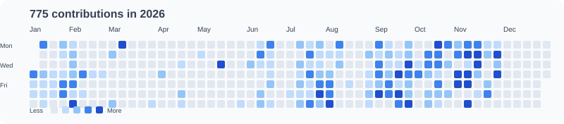

  <h3>Last 31 Days of Contributions</h3>

  <!-- GitHub contribution calendar -->
  <picture>
    <source
      media="(prefers-color-scheme: dark)"
      srcset="./profile/contributions-dark.svg"
    />
    
  </picture>

  
    Hover for date, count and X/Y coordinates:
    <a href="https://raw.githubusercontent.com/khadarbashajilan/khadarbashajilan/main/profile/contributions-dark.svg">dark</a>
    &middot;
    <a href="https://raw.githubusercontent.com/khadarbashajilan/khadarbashajilan/main/profile/contributions-light.svg">light</a>
  

   

  <!-- GitHub contribution streak -->
  <picture>
    <source
      media="(prefers-color-scheme: dark)"
      srcset="./profile/streak-dark.svg"
    />
    
  </picture>

   

  <!-- Most used programming languages -->
  <picture>
    <source
      media="(prefers-color-scheme: dark)"
      srcset="./profile/top-langs-dark.svg"
    />
    
  </picture>

